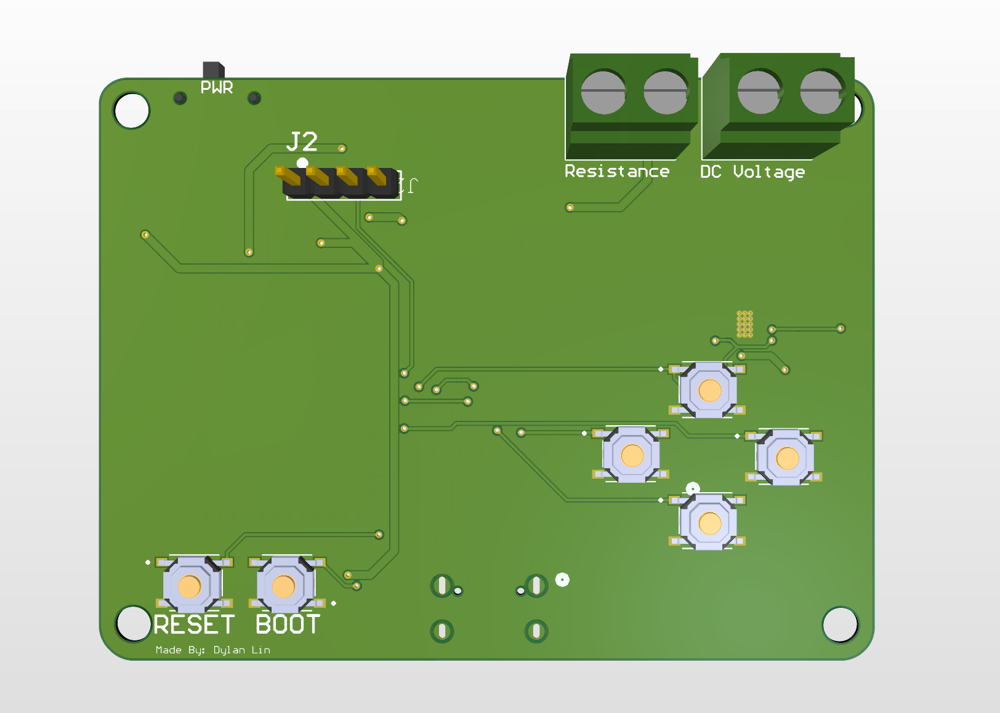
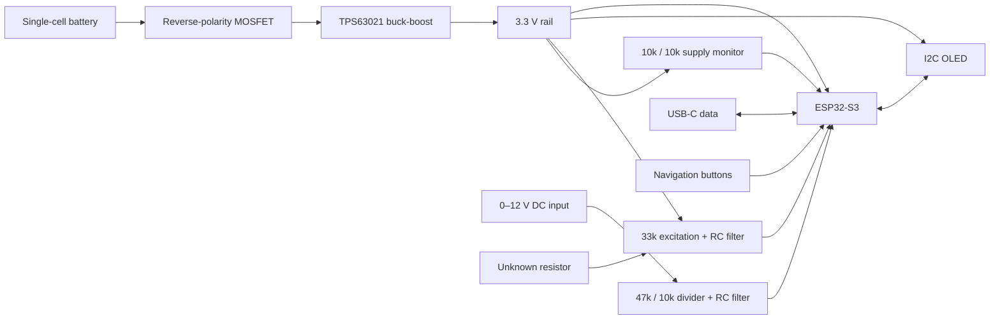
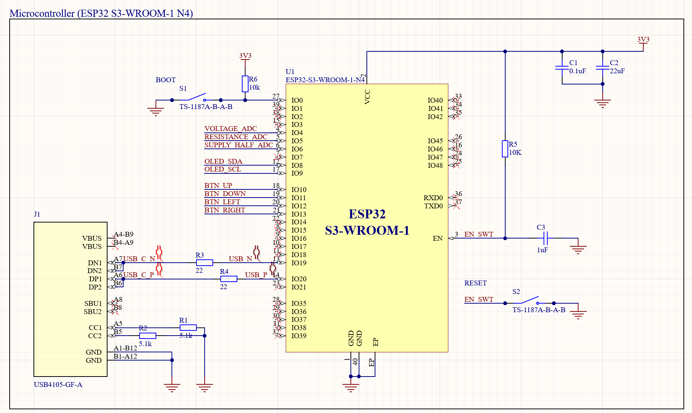
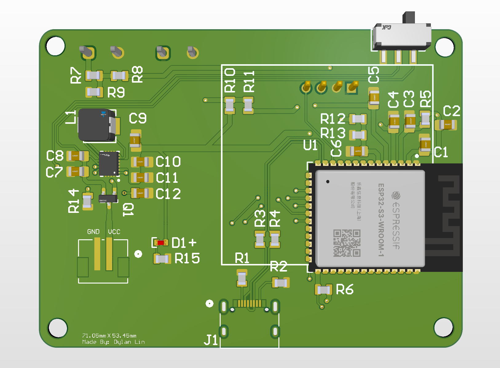
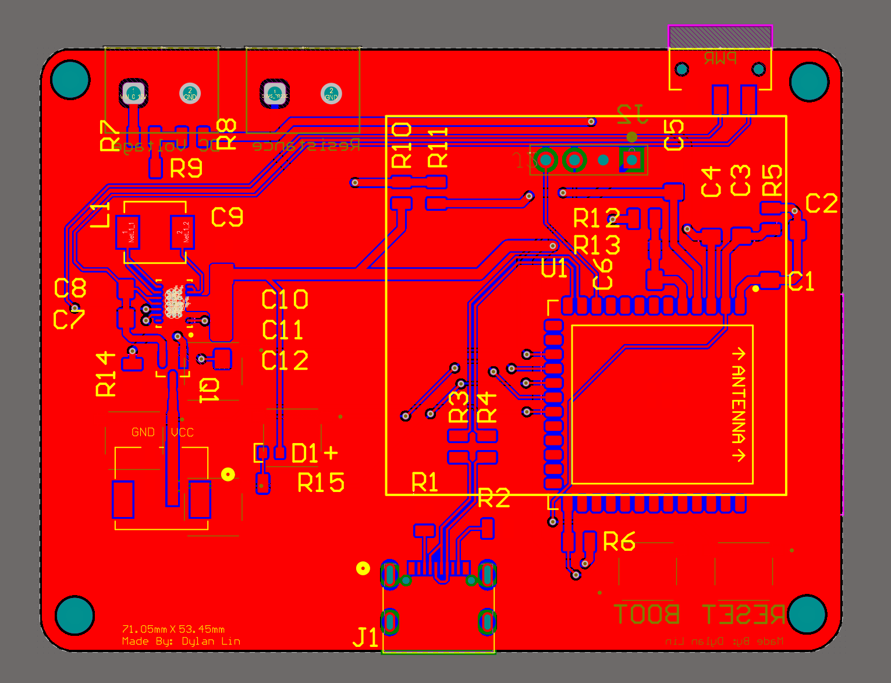
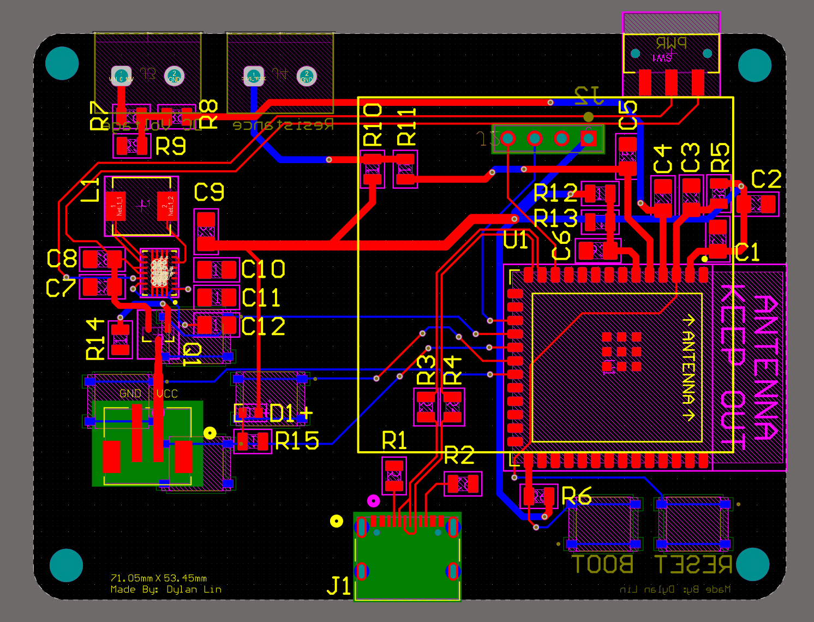
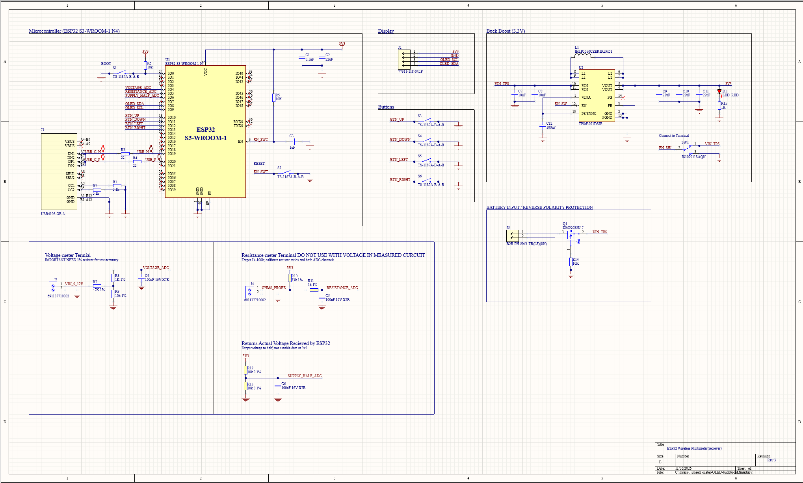
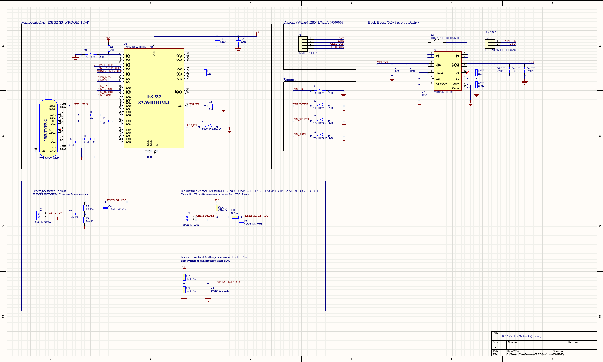
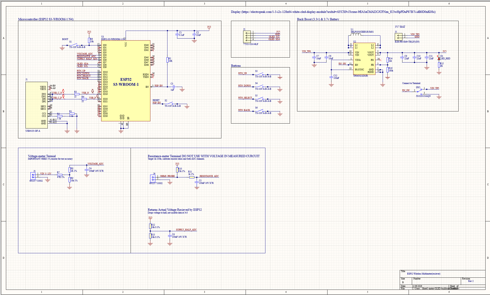

# ESP32-S3 Portable Voltage & Resistance Meter

**A custom battery-powered measurement board designed in Altium Designer — from analog signal conditioning and power architecture to PCB layout.**

I designed this board to measure low-voltage DC signals and discrete resistors, with an I²C OLED and four navigation buttons for a standalone interface. The project combines analog measurement, embedded interfaces, single-cell power conversion, and PCB integration in a **71.05 × 53.45 mm** board.

**Status — November 2026:** Schematic and PCB design completed; awaiting parts for assembly and bring-up. Images below are CAD renders and schematic captures. Measurement accuracy, battery life, regulator efficiency, and USB operation have not yet been bench-validated. Firmware and measured results are not included in this repository yet.



## Project at a glance

| Area | Design |
| :--- | :--- |
| Controller | ESP32-S3-WROOM-1-N4 |
| Voltage input | Positive 0–12 V DC design range; resistor divider and RC filtering |
| Resistance input | 1 kΩ–100 kΩ target range; 33 kΩ excitation resistor and supply monitoring |
| Power | Single-cell lithium-ion battery input; TPS63021 fixed 3.3 V buck-boost regulator |
| Battery input protection | DMP2035U P-channel MOSFET for reverse polarity |
| Interface | 3.3 V I²C OLED header, four navigation buttons, boot/reset controls |
| Programming | Native ESP32-S3 USB through USB-C; battery supplies the board |
| Design tools and deliverables | Altium schematic, PCB layout, BOM, and revision images |

The main engineering decisions were selecting a regulator for the **entire battery discharge range**, allocating precision where it affects the **measurement error budget**, and simplifying the display interface to use a **single 3.3 V rail**.

## System architecture



## 1. Power architecture: why I replaced the LDO

The original concept used a **TLV1117LV33 linear regulator** and a 5 V character LCD. An LDO can regulate 5 V down to 3.3 V, but it cannot maintain 3.3 V across the intended single-cell battery discharge range. It needs input headroom:

```text
VIN ≥ VOUT + Vdropout
```

A conventional single-cell lithium-ion battery is about 4.2 V when fully charged and falls below 3.3 V during discharge, depending on its allowed cutoff. Once the battery approaches the output voltage plus dropout, the LDO loses regulation; below 3.3 V it cannot boost the voltage at all. Thus, “the LDO doesn't work” means **it does not meet this battery-powered system requirement**, rather than that the part cannot operate from a suitable 5 V supply. See the [TI TLV1117LV datasheet](https://www.ti.com/lit/ds/symlink/tlv1117lv.pdf).

Linear conversion also dissipates the voltage difference as heat. At an illustrative 500 mA load from 5 V, `P = (5 − 3.3) × 0.5 = 0.85 W`, with an idealized efficiency of `3.3 / 5 = 66%`, ignoring quiescent current. These are calculations, not measured board results.

The final design uses the **TPS63021 buck-boost** to step down when the battery is above 3.3 V and step up when it is below 3.3 V. The tradeoff is additional switching noise, an inductor, and more demanding layout. Efficiency and load-transient behavior still need measurement on the assembled board.

The schematic uses a 1.5 µH inductor, two 10 µF input capacitors, three 22 µF output capacitors, and 100 nF VINA decoupling. **TPS63021 is the fixed 3.3 V version**, so its FB pin senses VOUT directly. Earlier screenshots retain an external divider from the adjustable-regulator concept; those are historical revisions, not the final connection. Component selection and layout are guided by the [TI TPS63020/TPS63021 datasheet](https://www.ti.com/lit/ds/symlink/tps63020.pdf).


### Battery polarity protection

Q1 adds reverse-polarity protection at the battery connector. A conducting MOSFET can have a smaller voltage loss than a series diode, helping preserve headroom at low battery voltage. Its loss depends on current and on-resistance: `P ≈ I² × RDS(on)`.

This circuit is **not a battery charger or a complete battery-management system**. The battery requires appropriate cell protection and external charging. USB VBUS is left disconnected from the power rail in the shown design.


## 2. Analog measurement and the tolerance budget


### DC voltage measurement

R7 = 47 kΩ and R9 = 10 kΩ scale the input before it reaches GPIO4:

```text
VADC = VIN × 10k / (47k + 10k)
VIN  = 5.7 × VADC
12 V input → approximately 2.105 V at the ADC
```

The divider presents about 57 kΩ to the measured source, so source loading must be considered. R8 = 1 kΩ and C4 = 100 nF filter the ADC input. Including the divider's Thévenin resistance, the nominal pole is approximately `1 / [2π × (1k + (47k || 10k)) × 100nF] ≈ 172 Hz`. This favors steady DC measurements over fast waveform capture.

### Resistance measurement

R10 = 33 kΩ excites the unknown resistor from the 3.3 V rail. GPIO5 measures the divider node; GPIO6 measures half the actual supply through R12 and R13. The intended calculation is:

```text
Vexc = VGPIO6 × (1 + R12 / R13)       ≈ 2 × VGPIO6
Rx   = R10 × VGPIO5 / (Vexc − VGPIO5)
```

At nominal 3.3 V excitation, 1 kΩ produces about 97 mV, 10 kΩ about 0.767 V, and 100 kΩ about 2.481 V. The low end is sensitive to ADC offset and noise; the upper end becomes more sensitive to excitation-voltage error. An open probe approaches the supply rail and must be reported as **open/out of range**, rather than converted into a misleading resistance value.

Measuring the excitation supply avoids assuming it is exactly 3.300 V. This does not eliminate ADC channel mismatch, nonlinearity, or calibration requirements. Firmware will need calibrated readings, settling time, averaging, and checks for invalid denominators. See [Espressif's ADC calibration documentation](https://docs.espressif.com/projects/esp-idf/en/v5.3.3/esp32s3/api-reference/peripherals/adc_calibration.html).

### Why 1% here and 0.1% there?

| Components | Specified tolerance / requirement | Engineering reason |
| :--- | :--- | :--- |
| R7, R9 voltage divider | 1% | Their ratio sets the voltage scale. Opposing tolerance extremes produce approximately −1.64% to +1.66% scale error before ADC error or calibration. A 1% resistor does not guarantee a 1% meter. |
| R10 excitation resistor | 1% | Its actual value directly scales the resistance calculation. Measuring and calibrating it reduces initial gain error. |
| R12, R13 supply divider | 0.1% each | Their ratio determines the inferred excitation voltage. Opposing extremes give approximately ±0.1% error in the nominal half-supply ratio, versus ±1% for 1% parts. |
| R8, R11 series filter resistors | 1% in the schematic | Primarily affect filtering and ADC settling; they do not set the ideal unloaded DC divider ratio. |
| C4–C6 ADC filter capacitors | 100 nF, 16 V, X7R | Effective capacitance, leakage, temperature behavior, and settling matter; 0.1% or 1% capacitance is not required for the DC gain calculation. |
| Power and decoupling capacitors | Values shown in the power schematic | Select for effective capacitance under DC bias, voltage rating, ESR, ripple, and regulator stability—not precision-resistor tolerances. |

The supply-divider accuracy matters because `Rx` depends on the difference between excitation and probe voltage. At 100 kΩ, the sensitivity to excitation error alone is about `1 + 100k / 33k ≈ 4.03`: a 0.1% excitation-estimate error contributes roughly 0.40% resistance error, with other terms held fixed. This is why tighter tolerance is useful at that divider.

**Tolerance is an initial component specification, not a complete accuracy claim.** Temperature coefficients, resistor ratio drift, ADC behavior, source impedance, noise, and calibration all belong in the eventual measured error budget. Capacitor tolerance mainly changes transient response here; it does not justify claiming 0.1% measurement accuracy.

## 3. Controller, USB, and user interface

The ESP32-S3 module provides the ADC inputs, native USB interface, and GPIO needed for the meter. The module approach avoids implementing the RF circuitry from discrete components. Wireless capability is available in the hardware, but no wireless measurement feature is demonstrated here.

| Signal | GPIO |
| :--- | :--- |
| Voltage / resistance / half-supply ADC | 4 / 5 / 6 |
| OLED SDA / SCL | 8 / 9 |
| Up / down / left / right buttons | 10 / 11 / 12 / 13 |
| USB D− / D+ | 19 / 20 |
| Boot | 0 |



USB-C uses separate 5.1 kΩ CC pull-downs and 22 Ω series resistors on the USB data lines. It is a data/programming connection in this revision, not a charging path. The board needs battery power during programming. The interface design is informed by [Espressif's hardware guidelines](https://docs.espressif.com/projects/esp-hardware-design-guidelines/en/latest/esp32s3/schematic-checklist.html).

Replacing the earlier parallel 5 V LCD with a **3.3 V I²C OLED** removes the separate display supply and level-shifting stage and reduces display signaling to two lines. Four active-low buttons provide navigation; firmware must configure pull-ups and debounce. Display pin order, controller compatibility, and the presence of I²C pull-ups must be checked against the delivered module.


## 4. PCB implementation

The board separates the front-facing controls and terminals from most of the electronics on the reverse side. The renders show the regulator and inductor grouped together, measurement circuitry near its terminals, and the ESP32 module at the board edge. Four mounting holes support future mechanical integration.



| Copper pours visible | Copper pours hidden for routing review |
| :---: | :---: |
|  |  |

Layout review priorities include compact switching-current loops, regulator thermal-pad grounding, ADC return paths, USB routing, and the module antenna clearance on every layer. These images document the layout; they are not evidence of measured signal integrity, RF performance, or manufacturing qualification.

## 5. Design evolution

The revision history records the move from the LDO/LCD concept to a single-cell, single-rail OLED design, followed by regulator feedback and battery-input refinements. **Use Rev 3 for the current schematic overview. Earlier captures are retained to show iteration and may contain superseded connections.**



<details>
<summary>Earlier concepts and revisions — three additional schematic images</summary>

### Original LDO and 5 V LCD concept

The initial architecture introduced a 5 V display domain and linear conversion to 3.3 V. It was superseded by the single-cell buck-boost and OLED architecture described above.


### Revision 1

Introduced the OLED, buck-boost power stage, separate measurement inputs, and supply-monitor channel. The regulator feedback arrangement was subsequently corrected for the fixed-output part.



### Revision 2

Refined USB connectivity and power controls. Revision 3 supersedes this view with direct VOUT feedback and the battery reverse-polarity circuit.



</details>

## 6. Bring-up and validation plan

The next milestone is a working, characterized prototype. Planned measurements will turn the design calculations into evidence:

| Test | Evidence to record |
| :--- | :--- |
| Pre-power inspection | Component orientation, shorts, footprint/pin mapping, net connectivity, and schematic-to-PCB consistency; verify reset and regulator-enable nets remain at their intended voltage levels |
| Power-stage bring-up | Current-limited startup; 3.3 V regulation across the selected battery's allowed range; ripple and load-step response |
| Thermal and power budget | Regulator/inductor temperatures, input/output power, idle/active current, and eventual battery runtime |
| USB and UI | Enumeration and programming, OLED communication, button debounce, boot/reset behavior |
| Voltage calibration | Multiple points across 0–12 V against a reference meter; gain, offset, noise, and repeatability |
| Resistance calibration | Known 1 kΩ, 10 kΩ, 33 kΩ, and 100 kΩ standards; open/short handling and supply dependence |
| Noise coupling | Compare ADC readings during display updates and different processor/radio loads |

**Operating scope:** This is a low-voltage bench prototype with shared ground, not a CAT-rated or isolated multimeter. Use only positive inputs within the intended range on a powered board. Resistance measurements require unpowered, discharged components isolated from other circuit paths. The shown inputs do not provide comprehensive overvoltage protection.

## Design files

- [Altium schematic](Schematic_Download%28ALTIUM%29) — restore the `.SchDoc` extension after downloading if needed.
- [Altium PCB](Esp32_PCB_Download%28ALTIUM%29) — restore the `.PcbDoc` extension after downloading if needed.
- [Bill of materials (Excel)](Bill_of_Materials_Download%28Excel%29.xlsx)
- [Schematic images and revision history](Schematic/)
- [PCB layout and 3D renders](PCB/)

**Author: Dylan Lin**
